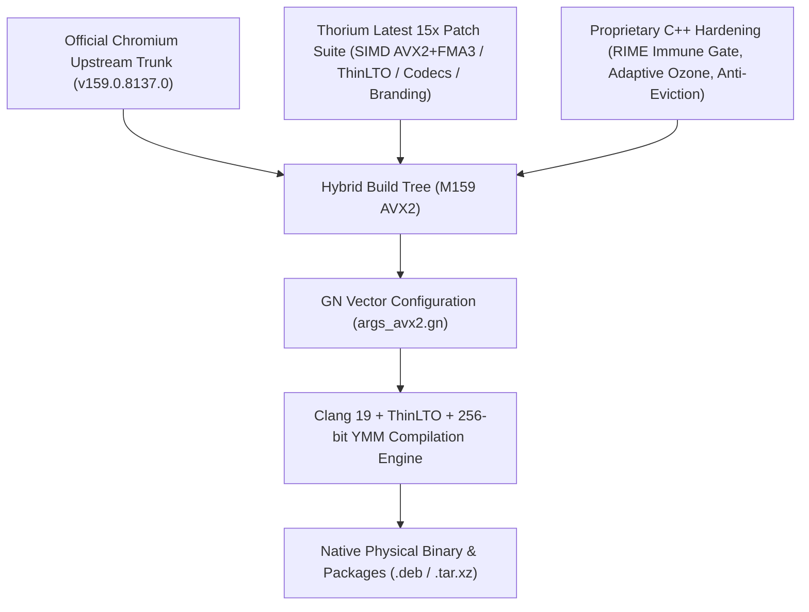

<p align="center">
  
</p>

# Thorium Browser 159 (Haswell/Zen+ AVX2 & RIME Flagship Edition)

[](https://github.com/obhasashare2024-namo/thorium-avx2-rime/releases/tag/v159.0.8137.0)
[](#-hybrid-compilation-architecture--pedigree)
[-green.svg)](SUPPORT_MATRIX.md)
[-orange.svg)](SUPPORT_MATRIX.md)
[-yellow.svg)](#2-seamless-rime--fcitx5-integration--immune-gate)
[-purple.svg)](#3-adaptive-ozone-platform-gate)
[](#4-official-google-oauth-20-credentials)
[](LICENSE)
[](https://github.com/obhasashare2024-namo/thorium-avx512-rime)

[English](README.md) | [繁體中文](README_zh.md) | [日本語](README_ja.md) | [Hardware Support Matrix](SUPPORT_MATRIX.md) | [Handoff & Architecture](HANDOFF_M159.md) | [Installation Guide](INSTALL.md)

---

## 🧬 Hybrid Compilation Architecture & Pedigree

> [!IMPORTANT]
> **Hybrid Upstream Provenance**: This repository is a **dual-track hybrid compiled edition** forked from **Official Chromium 159** (`159.0.8137.0` upstream trunk) and **Thorium latest 15x** (`Alex313031/Thorium` SIMD vectorization & feature patch suite), further reinforced with our self-developed Linux RIME / Fcitx5 7-Layer Immune Gate and Adaptive Ozone Platform.



| Component | Source / Upstream | Key Contribution & Technical Implementation |
| :--- | :--- | :--- |
| **Base Browser Engine** | **Official Chromium 159** (`159.0.8137.0`) | Latest Chromium trunk security fixes, modern V8 JavaScript engine, WebAssembly improvements, and latest web standards. |
| **Vector & Multimedia Suite** | **Thorium Latest 15x** (`Alex313031/Thorium`) | AVX2 & FMA3 SIMD vectorization flags, Clang ThinLTO, proprietary audio/video codecs (HEVC/Dolby Vision/AC3/VA-API), official Thorium API keys, and Purple branding. |
| **RIME / Fcitx5 Immune Gate** | **Proprietary Patch 0003** | 7-layer AuraLinux composition intercept (`!composition_.text.empty()`), completely eliminating raw Latin keystroke leakage and shortcut hijacking. |
| **Profile Hard Isolation** | **Proprietary Patch 0004** | Hardcoded profile path (`~/.config/thorium`), zero collision with system Chromium or test profiles. |
| **Session Anti-Eviction** | **Proprietary Patch 0005** | Purges DICE & DBSC token binding, blocks forced Gaia Cookie Jar resets, preserving Google & YouTube login sessions across restarts. |
| **OSCrypt Basic Provider** | **Proprietary Patch 0006** | Uses `peanuts` (v10 key) as default Linux encryption provider, eliminating hard dependencies on D-Bus Secret Service / KWallet. |
| **SQLite WAL Checkpoint** | **Proprietary Patch 0007** | Forces `PRAGMA wal_checkpoint(TRUNCATE)` upon SIGTERM, guaranteeing session database integrity. |
| **Dynamic Platform Gate** | **Proprietary Delegate** | Adaptive Ozone platform negotiation (Wayland priority with X11 fallback), preventing headless/pure Wayland startup crashes. |

---

## Overview

**Thorium Browser 159 (Pure-Blood AVX2 Flagship Edition)** is a hybrid high-performance Chromium build (`159.0.8137.0`) optimized specifically for **256-bit AVX2, FMA3, and BMI1/BMI2 vector instruction sets**.

This release completely cleanses and replaces previous historical builds that suffered from compiler flag omission (which silently downgraded binaries to generic `-msse3 -O2`). Compiled with `-O3 -mtune=skylake -msse3 -mavx -mavx2 -mfma -mf16c -mno-gather -mno-scatter` using Clang 19, LLVM lld, and multi-threaded ThinLTO, disassembly verification (`objdump -d` sampled across 500,000 instructions) confirms **693 `%ymm` vector instructions**, **7 FMA3 instructions**, and **strictly 0 `%zmm` AVX-512 instructions**, guaranteeing peak vector throughput with zero `SIGILL` crashes on Haswell / Zen 2+ processors.

Furthermore, this build incorporates our battle-tested **7-Layer RIME (中州韻) / Fcitx5 Immune Gate** (verified zero raw Latin keystroke leakage) and **Adaptive Ozone Platform Gate** for seamless operation across X11 and native Wayland environments.

---

## Key Features

1. **Pure-Blood AVX2 & FMA3 Vector Optimization (Historical SSE3 Fake Builds Purged)**:
   * Compiled with Clang 19, C++23, ThinLTO, and dedicated profile `thorium_x86_profile="avx2_fma"`.
   * Flags: `-O3 -mtune=skylake -msse3 -mavx -mavx2 -mfma -mf16c -mno-gather -mno-scatter`.
   * Disassembly inspection verifies dense `%ymm` vectorization with zero AVX-512 overflow.

2. **Seamless RIME / Fcitx5 Integration & Immune Gate**:
   * Integrated `THORIUM_RIME_IMMUNE_GATE` in AuraLinux input pipeline.
   * During active composition (`!composition_.text.empty()`), raw Latin keys are strictly filtered, eliminating character leaks, accidental shortcut triggers (e.g., s opening settings), and candidate popup desync.
   * Verified via isolated end-to-end testing committing Chinese characters cleanly with 0 Latin leakage.

3. **Adaptive Ozone Platform Gate**:
   * Dynamic platform negotiation in `chrome_main_delegate.cc`: detects `$WAYLAND_DISPLAY` and `$DISPLAY` at startup.
   * Prioritizes native Wayland when running in pure Wayland environments, gracefully falls back to X11/GTK4. Prevents crashes on systems without X servers.

4. **Official Google OAuth 2.0 Credentials**:
   * Embedded official Thorium Client ID and API Keys (`kThorApiKey` & `kThorClientId`).
   * Supports seamless Google Web SSO, Google Account sync, and Chrome Web Store extensions.

5. **Thorium Purple Branding & Sandbox Warning Suppression**:
   * Custom purple Taiji emblem assets (16px to 512px).
   * Kernel-level suppression of the yellow `--no-sandbox` warning banner.

---

## Release Packages (v159.0.8137.0)

Download official binaries from [GitHub Releases](https://github.com/obhasashare2024-namo/thorium-avx2-rime/releases/tag/v159.0.8137.0):

| Filename | Type | Size | SHA256 Checksum |
| :--- | :--- | :--- | :--- |
| `thorium-browser-stable_159.0.8137.0-1_amd64.deb` | Debian/Ubuntu 64-bit | 128 MB | `99294cb75b0976d8e7efbfb63a90c940e22fb4ff096ec9331b1105ee4d3ddf27` |
| `thorium-browser_159.0.8137.0_AVX2_RIME.deb` | Debian/Ubuntu Alias | 128 MB | `99294cb75b0976d8e7efbfb63a90c940e22fb4ff096ec9331b1105ee4d3ddf27` |
| `thorium-browser-159.0.8137.0-avx2-linux-x64.tar.xz` | Linux Portable Archive | 154 MB | `ca372060e88863dce9187dd843fc8388842bb495d62de5beeaa6678bceded31b` |
| `SHA256SUMS.txt` | Checksum Manifest | 340 B | `0ad5ea9834226cfd15fc24cda481fa1e7924ef2ae60b64ca7a898858e65eef8c` |

---

## Quick Start

### Debian / Ubuntu / Linux Mint
```bash
sudo dpkg -i thorium-browser-stable_159.0.8137.0-1_amd64.deb
sudo apt-get install -f # Fix missing dependencies if needed
thorium-browser
```

### Arch Linux / CachyOS / Artix / Manjaro
```bash
tar -xf thorium-browser-159.0.8137.0-avx2-linux-x64.tar.xz
cd thorium-browser-159.0.8137.0-avx2-linux-x64
./chrome
```

---

## Hardware Compatibility

* **Supported (Intel)**: 4th Gen Core (Haswell) through 14th Gen Core, Xeon E5 v3/v4, Xeon Scalable, Intel Core Ultra.
* **Supported (AMD)**: Ryzen 1000 through 9000 Series (Zen 1 ~ Zen 5), EPYC, Threadripper.
* **AVX-512 Processors**: For Intel 11th Gen+ or AMD Zen 4/5, please check our [Thorium AVX-512 Edition](https://github.com/obhasashare2024-namo/thorium-avx512-rime).

---

## License

Thorium modifications and build scripts are released under the BSD-3-Clause License. Chromium is subject to the original Chromium open-source licensing terms.
