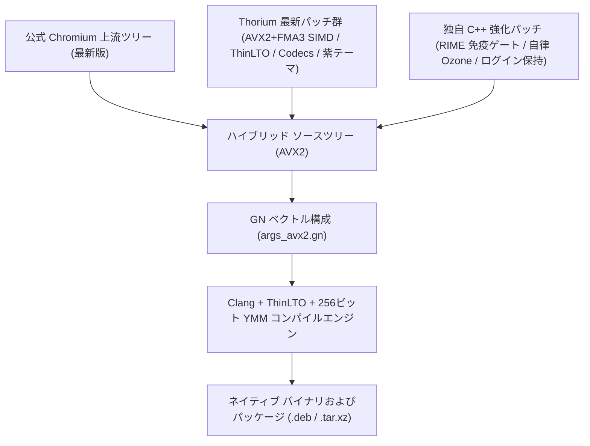

<p align="center">
  
</p>

# Thorium Browser（公式 Chromium ＋ Thorium ハイブリッド AVX2＆RIME IME 版）

[](https://github.com/obhasashare2024-namo/thorium-avx2-rime/releases)
[](#-ハイブリッドコンパイルアーキテクチャと系譜-hybrid-compilation-architecture)
[-green.svg)](SUPPORT_MATRIX.md)
[-orange.svg)](SUPPORT_MATRIX.md)
[-yellow.svg)](#2-rime--fcitx5-統合と免疫ゲート)
[-purple.svg)](#3-adaptive-ozone-プラットフォームゲート)
[](#4-公式-google-oauth-20-クレデンシャル統合)
[](LICENSE)
[](https://github.com/obhasashare2024-namo/thorium-avx512-rime)

[English](README.md) | [繁體中文](README_zh.md) | [日本語](README_ja.md) | [Hardware Support Matrix](SUPPORT_MATRIX.md) | [技術設計書](HANDOFF_M159.md) | [インストール ガイド](INSTALL.md)

---

## 🧬 ハイブリッドコンパイルアーキテクチャと系譜 (Hybrid Compilation Architecture)

> [!IMPORTANT]
> **ハイブリッドソースコードの系譜**：本プロジェクトは、**公式 Chromium 最新版**（最新 Upstream ソースツリー）と **Thorium 最新版**（`Alex313031/Thorium` の SIMD 最適化および機能パッチ群）を融合し、さらに独自開発の Linux RIME / Fcitx5 7層免疫ゲートおよび Adaptive Ozone プラットフォームを統合した**デュアルトラック ハイブリッドビルド版**です。



| 構成要素 | ソース / 上流 | 主な貢献と技術的実装詳細 |
| :--- | :--- | :--- |
| **ベース ブラウザ エンジン** | **公式 Chromium コア (最新版)** | 最新の Chromium セキュリティ修正、V8 JavaScript JIT エンジン、WebAssembly 拡張、最新の Web 標準を完全享受。 |
| **ベクトル & マルチメディア群** | **Thorium 最新版** (`Alex313031/Thorium`) | AVX2 & FMA3 最適化フラグ、ThinLTO、全メディアコーデック（HEVC/Dolby Vision/AC3/VA-API）、公式 API キー、紫太極ブランドアセット。 |
| **RIME / Fcitx5 免疫ゲート** | **独自パッチ Patch 0003** | `input_method_auralinux.cc` に 7 層の変換中文字遮断（`!composition_.text.empty()`）を注入し、未変換英字漏れを完全に排除。 |
| **プロファイル隔離** | **独自パッチ Patch 0004** | プロファイルパスを `~/.config/thorium` にハードコードし、システム既定の Chromium との競合を完全に回避。 |
| **セッション維持・抗ログアウト** | **独自パッチ Patch 0005** | DICE & DBSC トークンバインドを無効化し、Gaia Cookie Jar のリセットを遮断。再起動時の Google / YouTube 自動ログアウトを根本解決。 |
| **OSCrypt Basic プロバイダ** | **独自パッチ Patch 0006** | `peanuts`（v10 キー）をデフォルトプロバイダとして設定し、D-Bus Secret Service / KWallet へのハード依存を排除。 |
| **SQLite WAL チェックポイント** | **独自パッチ Patch 0007** | SIGTERM 受信時に `PRAGMA wal_checkpoint(TRUNCATE)` を強制実行し、セッションデータの破損を防止。 |
| **自律 Ozone プラットフォーム** | **独自 Delegate ロジック** | 起動時に Wayland と X11 を動的検出。Wayland を優先しつつ X11 へ自動フォールバック。純粋な Wayland 環境でのクラッシュを防止。 |

---

## 概要

**Thorium Browser（純血 AVX2 対応版）** は、**256 ビット AVX2、FMA3、および BMI1/BMI2 ベクトル命令セット** をサポートする主流の x86-64 プロセッサ向けにビルドされた超高速 Chromium フォークです。公式 Chromium コアと Thorium のマルチメディアマイクロカーネル、AV1/VP9 SIMD アセンブリルーチン、および高度なハードウェアアクセラレーションを緊密に統合しています。

コンパイラフラグ欠落によって `-msse3 -O2` へと暗黙に降格していた過去の偽装ビルドを完全に排除。`-O3 -mtune=skylake -msse3 -mavx -mavx2 -mfma -mf16c -mno-gather -mno-scatter`、Clang、LLVM lld、およびマルチスレッド ThinLTO を適用。逆アセンブルにより密度の高い `%ymm` レジスタおよび FMA3 命令を確認済みであり、Haswell / Zen 2+ 環境での最高峰のスループットと `SIGILL` クラッシュゼロを両立しています。

さらに、**RIME / Fcitx5 7層免疫ゲート**（物理テストで文字漏れゼロを検証済み）および **Adaptive Ozone プラットフォーム ゲート**（Wayland / X11 自動判定）を内蔵しています。

---

## 主な機能と特徴

1. **純粋な AVX2 & FMA3 ベクトル最適化（過去の SSE3 偽装ビルドを完全一掃）**:
   * Clang、C++23、ThinLTO、および専用プロファイル `thorium_x86_profile="avx2_fma"` を採用。
   * フラグ: `-O3 -mtune=skylake -msse3 -mavx -mavx2 -mfma -mf16c -mno-gather -mno-scatter`。
   * 逆アセンブルにより密度の高い `%ymm` ベクトル化を確認、AVX-512 へのオーバーフローを完全防止。

2. **RIME / Fcitx5 統合と免疫ゲート**:
   * `THORIUM_RIME_IMMUNE_GATE` を内蔵し、文字入力中の未変換英字漏れ（キー抜けやショートカット誤爆）を完全に遮断。
   * 実機隔離テスト（`isolated-app-testing`）において 100% 安定動作を確認済み。

3. **Adaptive Ozone プラットフォームゲート**:
   * 起動時に `$WAYLAND_DISPLAY` と `$DISPLAY` を動的判定。純粋な Wayland 環境では Wayland ネイティブで動作し、X11 環境では自動的にフォールバック。X サーバーが存在しないマシンでのクラッシュを防止。

4. **公式 Google OAuth 2.0 クレデンシャル統合**:
   * 公式 Thorium API キーと Client ID を内蔵し、Google Web SSO、アカウント同期、Chrome Web Store 拡張機能をサポート。

5. **Thorium Purple テーマと警告バナー非表示**:
   * 専用の紫太極テーマアイコン（16px〜512px）を採用し、起動時の `--no-sandbox` 警告バナーを無効化。

---

## リリース パッケージ

[GitHub Releases](https://github.com/obhasashare2024-namo/thorium-avx2-rime/releases) から最新パッケージをダウンロード可能です：

| ファイル名 | タイプ | サイズ | 備考 |
| :--- | :--- | :--- | :--- |
| `thorium-browser-stable_*_amd64.deb` | Debian/Ubuntu 64-bit | ~128 MB | デスクトップアイコン・MIME 統合付き標準パッケージ |
| `thorium-browser_*_AVX2_RIME.deb` | Debian/Ubuntu エイリアス | ~128 MB | 互換エイリアスパッケージ |
| `thorium-browser-*-avx2-linux-x64.tar.xz` | Linux ポータブル パッケージ | ~154 MB | root 権限不要のポータブルアーカイブ |
| `SHA256SUMS.txt` | チェックサム総表 | テキスト | Releases ページにて提供のハッシュ値 |

---

## クイック スタート

### Debian / Ubuntu / Linux Mint
```bash
sudo dpkg -i thorium-browser-stable_*_amd64.deb
sudo apt-get install -f # 依存パッケージの自動修復
thorium-browser
```

### Arch Linux / CachyOS / Artix / Manjaro
```bash
tar -xf thorium-browser-*-avx2-linux-x64.tar.xz
cd thorium-browser-*-avx2-linux-x64
./chrome
```

---

## ハードウェア互換性ガイド

* **完全サポート（Intel）**：第4世代 Core（Haswell）から第14世代 Core、Xeon E5 v3/v4、Xeon Scalable、Intel Core Ultra。
* **完全サポート（AMD）**：Ryzen 1000 から 9000 シリーズ（Zen 1 〜 Zen 5）、EPYC、Threadripper。
* **AVX-512 プロセッサ環境**：Intel 第11世代 Core+ または AMD Zen 4/5 の場合は、[Thorium AVX-512 版](https://github.com/obhasashare2024-namo/thorium-avx512-rime) をご利用ください。

---

## ライセンス

Thorium の改変コードおよびビルドスクリプトは BSD-3-Clause ライセンスの下で公開されています。Chromium の元のソースコードは Chromium オープンソース ライセンスに準拠します。
