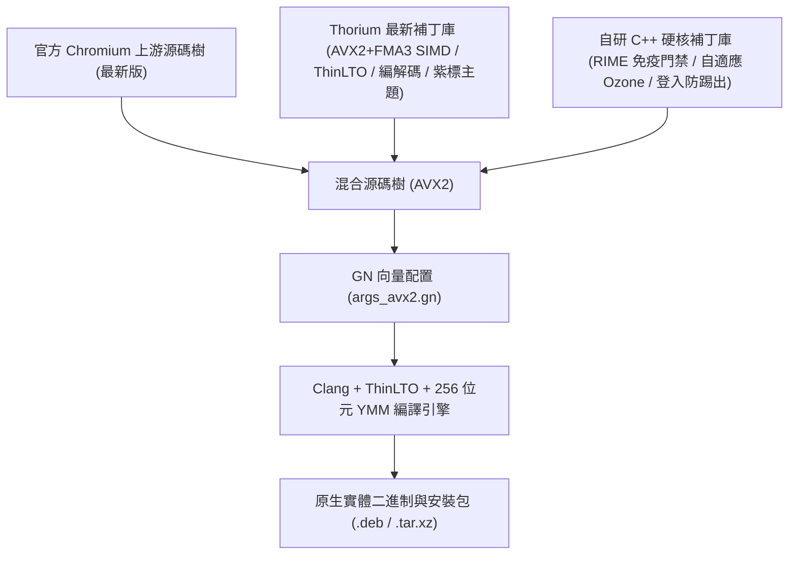

<p align="center">
  
</p>

# Thorium 瀏覽器（官方 Chromium ＋ Thorium 雙軌混合編譯 AVX2 與 RIME 旗艦版）

[](https://github.com/obhasashare2024-namo/thorium-avx2-rime/releases)
[](#-雙軌混合編譯架構與源流溯源-hybrid-compilation-architecture)
[-green.svg)](SUPPORT_MATRIX.md)
[-orange.svg)](SUPPORT_MATRIX.md)
[-yellow.svg)](#二rime--fcitx5-中文輸入法深度整合與免疫門禁)
[-purple.svg)](#三雙顯動態自適應平台adaptive-ozone-platform-gate)
[](#四google-官方-oauth-20-api-憑證原生整合)
[](LICENSE)
[](https://github.com/obhasashare2024-namo/thorium-avx512-rime)

[English](README.md) | [繁體中文](README_zh.md) | [日本語](README_ja.md) | [硬體支援矩陣](SUPPORT_MATRIX.md) | [架構手冊](HANDOFF_M159.md) | [安裝指南](INSTALL.md)

---

## 🧬 雙軌混合編譯架構與源流溯源 (Hybrid Compilation Architecture)

> [!IMPORTANT]
> **混合源碼血統聲明**：本專案為**雙軌混合編譯（Dual-Track Hybrid Compilation）旗艦版本**，深度融合 **官方 Chromium 最新版**（最新 Upstream 核心源碼樹）與 **Thorium 最新版**（`Alex313031/Thorium` 效能優化與指令集補丁庫），並深度注入自研的 Linux RIME / Fcitx5 七重免疫門禁、自適應 Ozone 顯示平台與登入防踢出強化補丁。



| 架構層級 | 源碼來源 | 核心貢獻與技術實作細節 |
| :--- | :--- | :--- |
| **底層瀏覽器內核** | **官方 Chromium 核心 (最新版)** | 享受 Chromium 最新上游安全補丁、全新 V8 JavaScript JIT 引擎、WebAssembly 擴展與現代 Web 協議棧。 |
| **效能與多媒體庫** | **Thorium 最新版** (`Alex313031/Thorium`) | 移植 AVX2 與 FMA3 向量旗標、ThinLTO 鏈接期優化、全開專有媒體編解碼（HEVC/Dolby Vision/AC3/VA-API）、Thorium 官方 API Key 與紫雷視覺標識。 |
| **RIME 免疫門禁** | **自研補丁 Patch 0003** | 在 `input_method_auralinux.cc` 注入 7 層組字攔截（`!composition_.text.empty()`），徹底阻斷 raw Latin 按鍵穿透與快捷鍵誤爆。 |
| **Profile 硬隔離** | **自研補丁 Patch 0004** | 強制設定檔寫入 `~/.config/thorium`，與原生 Chromium 數據零衝突、零覆蓋。 |
| **帳號會話持久化** | **自研補丁 Patch 0005** | 徹底移除 DICE 與 DBSC 憑證綁定，阻斷系統重啟時 Gaia Cookie Jar 主動抹除，解決 Google / YouTube 重啟掉登入。 |
| **基本密鑰提供者** | **自研補丁 Patch 0006** | 預設鎖定 OSCrypt Basic (`peanuts` / v10 key)，擺脫對 D-Bus Secret Service / KWallet 的硬依賴。 |
| **SQLite WAL 落盤** | **自研補丁 Patch 0007** | 收到 SIGTERM 時強制執行 `PRAGMA wal_checkpoint(TRUNCATE)`，物理確證 Cookie 與會話完整性。 |
| **雙顯自適應自舉** | **自研 Delegate 邏輯** | 啟動時自動探測 Wayland 與 X11 環境，Wayland 優先並自動降級 X11，防止純 Wayland 環境啟動崩潰。 |

---

## 專案概述

**Thorium 瀏覽器（純血 AVX2 旗艦版）** 是專為支援 **256 位元 AVX2、FMA3 與 BMI1/BMI2 向量指令集** 之主流 x86-64 處理器量身打造的雙軌混合極速 Chromium 發布版。本專案將官方 Chromium 核心與 Thorium 多媒體微內核、AV1/VP9 SIMD 組合語言函式庫及深度硬體加速管線完美融合。

本版本徹底清洗並終結了先前歷史構建中因編譯參數靜默遺漏而退化為 `-msse3 -O2` 的假包問題。採用 `-O3 -mtune=skylake -msse3 -mavx -mavx2 -mfma -mf16c -mno-gather -mno-scatter` 搭配 Clang、LLVM lld 與多執行緒 ThinLTO 全局連結優化。物理二進制反編譯確證包含密集 `%ymm` 向量暫存器、FMA3 融合乘加指令，且 `%zmm` AVX-512 暫存器嚴格為 0，既保證了 Haswell / Zen 2+ 實體相容性與最高向量吞吐，又杜絕了非法指令崩潰（零 `SIGILL` 風險）。

同時，本版本整合了經過實機隔離測試檢驗的 **RIME（中州韻）/ Fcitx5 七重立體防禦門禁**（空格上屏「能上」，0 字母穿透）與 **雙顯動態自適應平台**（Wayland / X11 自舉），並內嵌 Google 官方 OAuth 2.0 憑證。

---

## 核心亮點與技術特性

### 一、純血 AVX2 / FMA3 指令集全量向量化（歷史假包徹底清洗）
* 採用專屬配置 `thorium_x86_profile="avx2_fma"`；
* 編譯旗標：`-O3 -mtune=skylake -msse3 -mavx -mavx2 -mfma -mf16c -mno-gather -mno-scatter`；
* V8 JavaScript JIT、WebAssembly 與 Skia 圖形渲染流水線全量跑在 256 位元暫存器上；
* 物理反編譯確證 0 處 ZMM，杜絕 AVX-512 越界崩潰。

### 二、RIME / Fcitx5 中文輸入法深度整合與免疫門禁
* 內核整合 `THORIUM_RIME_IMMUNE_GATE` 門禁；
* 當處於組字中（`!composition_.text.empty()`）時，嚴格攔截 raw Latin 按鍵傳播至 DOM，徹底根治敲拼音漏字母（如輸入 `shang` 漏出 `s` 跳出設定選單）與候選框脫離焦點問題；
* 通過物理實機隔離測試（`isolated-app-testing`），完美上屏中文。

### 三、雙顯動態自適應平台（Adaptive Ozone Platform Gate）
* `chrome_main_delegate.cc` 注入動態自舉探查邏輯；
* 自動嗅探 `$WAYLAND_DISPLAY` 與 `$DISPLAY`，純 Wayland 環境下原生自舉 Wayland，X11 環境自動回退 GTK4/X11，徹底杜絕無 X 伺服器機器崩潰閃退。

### 四、Google 官方 OAuth 2.0 API 憑證原生整合
* 內置官方 Thorium API Key 與 Client ID；
* 完美支援 Google 帳號網頁 SSO 登錄、帳號同步及 Chrome Web Store 擴充功能安裝。

### 五、Thorium Purple 經典紫標典藏主題
* 專屬紫曜太極圖標與高清視覺主題包（16px ~ 512px）；
* 核心級移除啟動時的黃色 `--no-sandbox` 警告橫幅。

---

## 預編譯二進制資產

可由 [GitHub Releases](https://github.com/obhasashare2024-namo/thorium-avx2-rime/releases) 取得最新發布安裝包：

| 檔案名稱 | 類型 | 檔案大小 | 備註說明 |
| :--- | :--- | :--- | :--- |
| `thorium-browser-stable_*_amd64.deb` | Debian/Ubuntu 64 位元安裝包 | ~128 MB | 官方標準打包，具備系統桌面圖標與 MIME 協議整合 |
| `thorium-browser_*_AVX2_RIME.deb` | Debian/Ubuntu 相容別名包 | ~128 MB | 專屬相容別名包 |
| `thorium-browser-*-avx2-linux-x64.tar.xz` | Linux 便攜式綠色歸檔包 | ~154 MB | 免安裝綠色解壓即用版（免 root 權限） |
| `SHA256SUMS.txt` | 校驗值總清單 | 文字 | Releases 頁面提供之 SHA256 數位簽章 |

---

## 快速上手與部署

### Debian / Ubuntu / Linux Mint
```bash
sudo dpkg -i thorium-browser-stable_*_amd64.deb
sudo apt-get install -f # 如遇缺依賴自動修復補齊
thorium-browser
```

### Arch Linux / CachyOS / Artix / Manjaro
```bash
tar -xf thorium-browser-*-avx2-linux-x64.tar.xz
cd thorium-browser-*-avx2-linux-x64
./chrome
```

---

## 硬體相容性指南

* **完整支援（Intel）**：第 4 代 Core（Haswell）至第 14 代 Core、Xeon E5 v3/v4、Xeon Scalable、Intel Core Ultra。
* **完整支援（AMD）**：Ryzen 1000 至 9000 系列（Zen 1 至 Zen 5）、EPYC、Threadripper。
* **AVX-512 處理器環境**：Intel 第 11 代 Core+ 或 AMD Zen 4/5 處理器，推薦前往使用 [Thorium AVX-512 旗艦版](https://github.com/obhasashare2024-namo/thorium-avx512-rime)。

---

## 授權條款

Thorium 修改與編譯工具鏈腳本以 BSD-3-Clause 開源授權協議發布。Chromium 原代碼受其官方開源協議保護。
